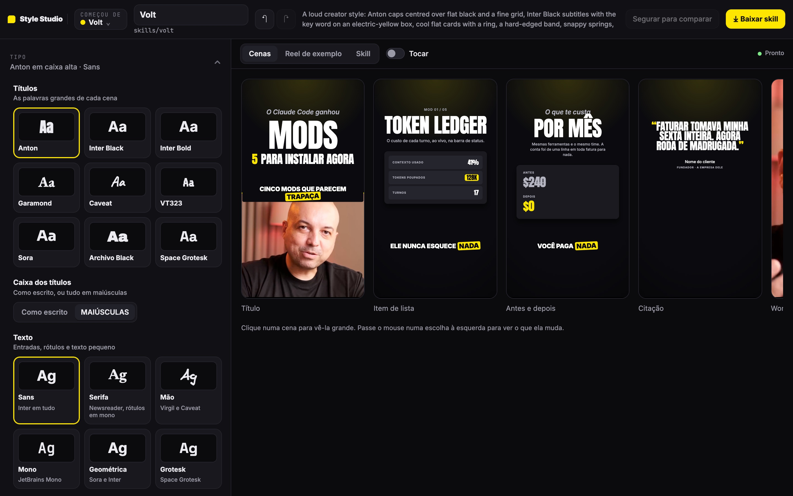
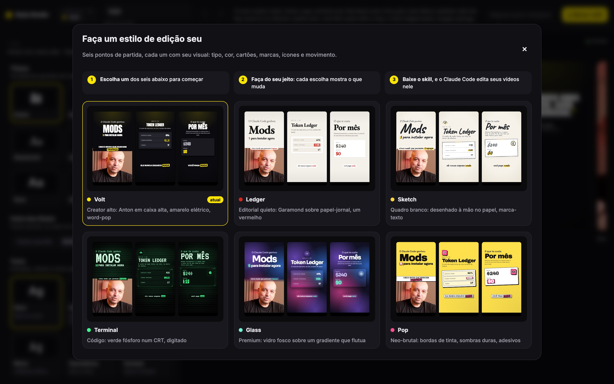
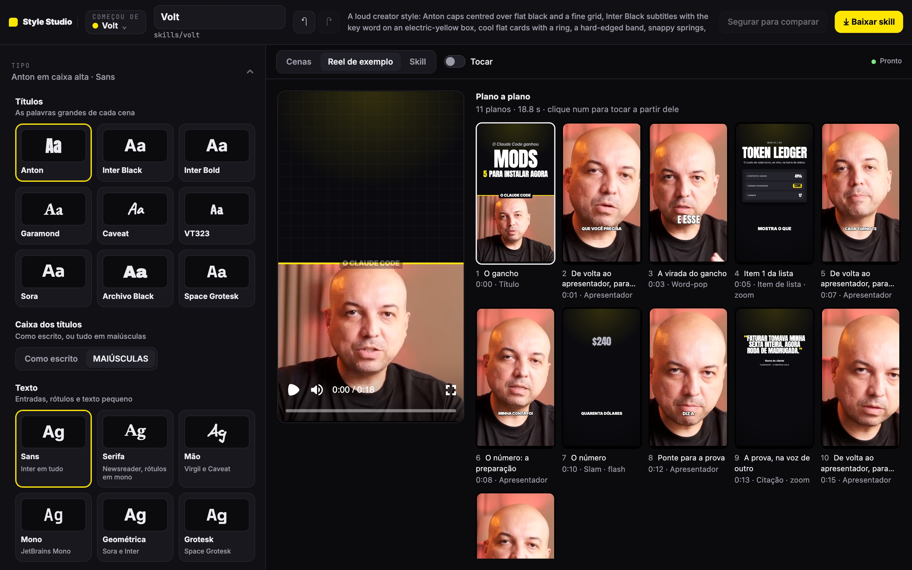
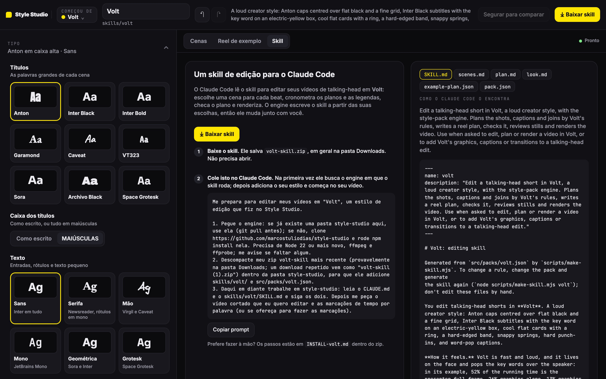

# Style Studio

**Crie um estilo de edição de vídeo e deixe o Claude Code editar seus talking-heads nele.**
Por [Marcos Tulio](https://marcostulio.com). No ar em **[studio.marcostulio.com](https://studio.marcostulio.com)**.



Você escolhe um dos seis estilos de partida, mexe no que quiser (fontes, cores, cenários, cartões, legendas,
movimento) e vê cada mudança nas cenas na hora. Quando gostar, baixa o **skill**: uma pasta que o Claude Code lê para
editar os seus vídeos exatamente naquele estilo, com um engine em [Remotion](https://www.remotion.dev) que planeja os
planos, escreve as legendas, checa e renderiza.

## Como funciona

1. **Escolha um ponto de partida.** Volt, Ledger, Sketch, Terminal, Glass ou Pop, cada um com um visual e um jeito de
   editar diferentes, não só uma troca de cores.

   

2. **Faça do seu jeito.** Cada escolha do painel mostra, na prévia, o que ela muda. Passe o mouse num controle e as
   cenas afetadas se destacam. Segure "comparar" para ver como o estilo veio.

3. **Veja o reel de exemplo.** Um vídeo curto inteiro, plano a plano, montado pelas regras do seu estilo.

   

4. **Baixe o skill.** Um zip com `skills/<seu-estilo>/` (o SKILL.md e as referências que o Claude Code lê), o pack
   do estilo e um passo a passo. Cole o prompt pronto no Claude Code e ele instala o engine e começa no seu vídeo.

   

## O que o Claude Code faz com o skill

Na sua máquina, com o engine instalado (`git clone` deste repositório e `npm install`), você entrega um vídeo cortado
e as marcações de tempo por palavra (o Whisper faz). O Claude Code lê o skill, quebra a fala em beats, escolhe uma
cena para cada um, escreve o plano do reel, checa contra as regras do estilo, renderiza stills para revisar e por fim o
vídeo em 1080x1920. Um estilo é um arquivo JSON (`src/packs/<id>.json`): tudo que o engine desenha vem dele.

## Rodar o Studio na sua máquina

Precisa de Node 22 ou mais novo, ffmpeg e ffprobe.

```bash
git clone https://github.com/marcostuliodias/style-studio && cd style-studio && npm install
```

```bash
npm run studio:web
```

Abre em <http://localhost:3490>. Coloque um talking-head horizontal em `public/footage/demo/plate.mp4` e meça o
rosto em `src/board/demo-shoot.json` (ou use "Usar meu footage" no próprio Studio). Localmente o Studio também
exporta o reel de exemplo em MP4 e aceita o seu footage; no site público essas duas coisas ficam desligadas.

Para publicar numa VPS ou no Fly.io: [`deploy/README.md`](deploy/README.md). Como o Studio é feito por dentro:
[`studio/README.md`](studio/README.md).

## Estrutura

| Pasta | O que é |
|---|---|
| `studio/` | O Style Studio web: painel, prévia com Remotion Player, API local (skill, render, footage) e servidor |
| `src/engine/`, `src/kit/`, `src/scenes/`, `src/pack-scenes/` | O engine: lê o pack e desenha as cenas |
| `src/packs/` | Os seis estilos, como JSON |
| `src/reel/` | O reel: um vídeo inteiro a partir de um plano |
| `skills/` | O skill de cada estilo, gerado por `scripts/make-skill.mjs` |
| `scripts/` | Gerar skill, checar plano, renderizar reel e stills, medir o footage |
| `deploy/` | Dockerfile, Compose, nginx, Fly.io |

## Créditos

O engine de packs de estilo é o [style-studio-engine](https://github.com/kelano86/style-studio-engine) de kelano86,
MIT. Este repositório adiciona o Studio web, a API local, o deploy e a tradução do roteiro de demonstração para o
português. Fontes com licença OFL (Anton, Inter, EB Garamond, Newsreader, Caveat, Virgil, VT323, Sora, Archivo
Black, Space Grotesk, JetBrains Mono). Licença MIT, veja [LICENSE](LICENSE).
