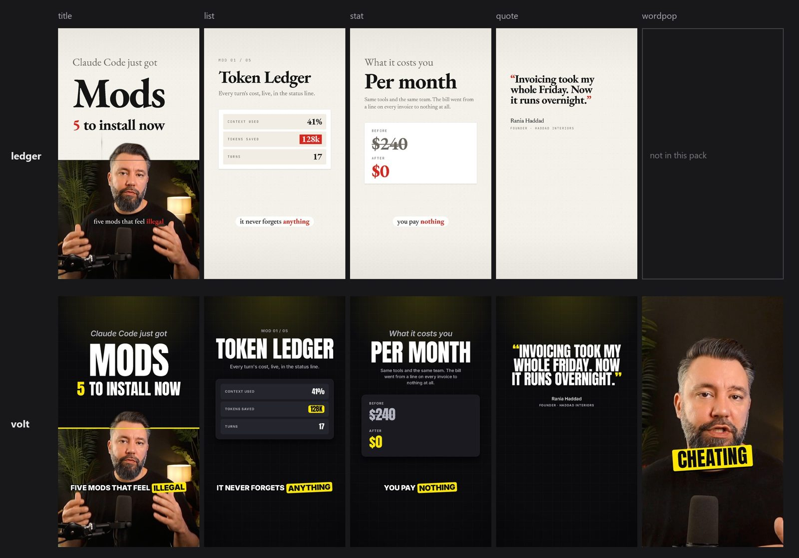

# Style Studio engine

> **Este fork** adiciona o Style Studio web em [`studio/`](studio/README.md): o painel de escolhas, a prévia ao vivo,
> o skill em zip, a exportação de vídeo e o footage próprio, com o roteiro de demonstração em português.
> `npm run studio:web` abre em <http://localhost:3490>. O engine original é de [kelano86](https://github.com/kelano86/style-studio-engine), MIT.

The video engine behind [Style Studio](https://videoeditskill.synteq.app). Pick an editing style there, make it yours
(the fonts, the colours, the backgrounds, how the animations move), download its skill, and Claude Code edits your
talking-head videos in that style with this engine: it plans the shots, writes the captions, checks the plan and
renders the video, all in code with [Remotion](https://www.remotion.dev).

A **style pack** is a JSON file that holds everything about how a style looks and moves: fonts, palette, grounds, cards,
captions, layout rules, presenter framing, motion, pace, and the scene types the style brings. The engine renders any
scene in any pack, and each pack comes with a Claude Code editing skill written from it.

Six packs ship with it, each a different look and a different edit rather than a recolour:

| Pack | The look | The edit |
|---|---|---|
| **Volt** | Loud creator: Anton caps centred on black and a grid, electric yellow | On the face: a punch-in on every line, word-pop on the payoff, the number slammed full frame (`slam`), zoom-throughs and flashes |
| **Ledger** | Quiet editorial: EB Garamond set left on newsprint, one red, hairline cards | On the page: the presenter framed in the band or a tile, numbers as an editorial chart (`chart`), wipes led by a hairline, long holds |
| **Sketch** | Whiteboard: Caveat and Virgil on graph paper, marker highlights, hand-drawn cards with tape, a torn-paper camera band | Drawn on: notes and arrows doodled over the footage on the payoff and the end (`doodle`), paper graphics between, a torn-paper wipe onto the page, captions arriving in steps |
| **Terminal** | Code: VT323 and JetBrains Mono in phosphor green on a CRT, inverted key words, pixel icons, the camera in a window | On screen: commands typed and printed above the camera window (`command`), glitch cuts, typed captions, word-pop |
| **Glass** | Premium: Sora and Inter over a drifting mesh, frosted glass cards and captions, glowing hero words, duotone icons | In the room: the presenter in a feathered band beside frosted cards, a list's items and its numbers floating in front of them as the focus pulls off (`float`), blur dissolves into the number and the proof |
| **Pop** | Neo-brutal: Archivo Black on lemon yellow and halftone, ink borders and hard shadows, leaning cards, sticker icons | Slapped on: stickers and starbursts over the presenter (`sticker`), whip pans, flashes, word-pop |



*The same scenes and words in two of them: **Ledger** (top) and **Volt** (bottom). Word-pop is a scene type only some
packs bring, so Ledger refuses to render it.*

## What you need

- [Node.js](https://nodejs.org) 22 or newer
- [ffmpeg](https://ffmpeg.org) and ffprobe on your PATH
- [Claude Code](https://www.anthropic.com/claude-code)
- A talking-head video, already cut: takes chosen, dead air out, one continuous file
- Word timings for it, a time for each word. If you don't have them, Claude can make them with
  [Whisper](https://github.com/openai/whisper): `pip install -U openai-whisper`, then, in the video's folder,
  `whisper plate.mp4 --model small --word_timestamps True --output_format json` writes `plate.json` beside it

## Set up

```bash
git clone https://github.com/kelano86/style-studio-engine
```

```bash
cd style-studio-engine
```

```bash
npm install
```

The first render downloads the headless Chrome that Remotion renders with.

## Edit a video

1. **Get a style.** The six above are already in `skills/`. For your own, set it up in
   [Style Studio](https://videoeditskill.synteq.app) and click **Download skill**, then unzip the download in this
   folder (the one with `package.json`). It adds `skills/<your-style>/` and `src/packs/<your-style>.json`, and the
   engine finds it there by name: there's nothing else to set up.
2. **Add your video.** Put the cut video in a folder of its own as `plate.mp4`, for example
   `public/footage/my-first-reel/plate.mp4`, with its word timings beside it. Footage and plans stay out of git.
3. **Ask Claude Code.** Open Claude Code in this folder and ask it to edit the video in your style, for example:
   *"Edit public/footage/my-first-reel/plate.mp4 in My Volt. The word timings are in plate.json next to it."*

Claude reads the style's skill, lays out the shots, checks the plan (`scripts/check-plan.mjs`), renders a still per
shot to review, and then renders the video to `out/reels/<video>.mp4`. The reel is 1080x1920 at 30 fps; your video can
be landscape or vertical.

The board (`npm run studio`) and each skill's `example-plan.json` play demo footage that isn't included: to look
at them, put any landscape talking-head clip at `public/footage/demo/plate.mp4` and set its face in
`src/board/demo-shoot.json`. Your own edits don't need it.

## How it fits together

| Layer | What it is | Where |
|---|---|---|
| **Pack** | The style, as data. Validated when a render starts. | `src/packs/*.json`, schema in `src/engine/pack.ts` |
| **Engine** | Reads the pack: fonts and the size rule, type, colour, motion, letter metrics. | `src/engine/` |
| **Kit** | Parts every scene uses: ground, cards, fitted lines, voices, subtitles, the presenter (full frame, half band, tile). | `src/kit/` |
| **Shared scenes** | Scenes any pack can render: title, talk (the presenter in a layout), list item, before/after, quote. | `src/scenes/` |
| **Pack scenes** | Scene types a pack brings and declares (`scenes.brings`); no other pack can render them. | `src/pack-scenes/` |
| **Reel** | A whole video from a reel plan (JSON): shots on the edit's timeline, the pack's joins, a caption track. What each scene is for and its props are in the scene catalogue. | `src/reel/`, catalogue `src/reel/scenes.json` |
| **Skills** | A Claude Code editing skill per pack, generated from it, that plans, checks and renders reels in that style. | `skills/<pack>/`, made by `scripts/make-skill.mjs` |

### The signature: what makes a style its own

Fonts and colours alone make a recolour. A pack's `signature` sets the details the kit draws everywhere they apply:

- `surface`: what cards are: lit solid, frosted glass, paper with a hand-drawn border and tape (`sketch`), an ink border
  with a hard shadow (`brutal`), or a terminal panel with corner marks.
- `mark`: how the hero word and the winning number are picked out: the hero colour alone, a marker highlight, a hand
  underline, a scribbled circle, a filled block, an inverted block, or a glow (`src/kit/Mark.tsx`).
- `icons`: one icon set (`src/kit/Icon.tsx`, 19 icons built from shapes) drawn as lines, duotone, solid, hand-drawn,
  pixels (rasterised from the same shapes) or stickers. List items and before/afters take an `icon`.
- `reveal`: how lines arrive: rising, in steps like drawn animation, typed in, or out of a blur (`src/kit/Rise.tsx`).
- `chrome` and `edge`: a window's title bar or tape on the presenter's tile; a torn-paper edge on the camera band.
- `tilt`, `rough`, `boil`: how far cards lean, how much hand-drawn strokes wobble, and how often they redraw.

Every field is optional, and a pack without a signature draws exactly as before. Hand-drawn strokes come from
`src/kit/rough.ts`, seeded, so a frame is the same on every render.

### The edit: what makes a style move like its own

The signature makes a style's frames its own; the edit is what happens between them, and a re-skin leaves it the same.
Four parts of a pack set it, all optional (left out, a pack renders and plans as before):

- **Its own scene types** (`scenes.brings`, `src/pack-scenes/`), where most of a style's identity lives. Each changes how
  the presenter is used, not just how a card looks:

  | Scene | Brought by | What it does |
  |---|---|---|
  | `word-pop` | Volt, Terminal, Pop | The spoken words popping in big over the speaker, the key word on a box with a punch-in |
  | `slam` | Volt | One number slamming down full frame on its word, the old value struck out above it, a shake and a shockwave |
  | `chart` | Ledger | An editorial bar chart on the page: bars drawn from a hairline axis, values counting up, the change, a source line |
  | `doodle` | Sketch | A handwritten note taped above the presenter's head and an arrow drawn down to them, over the footage |
  | `command` | Terminal | A terminal window typing a command and printing its output, above the camera in its own window |
  | `float` | Glass | The presenter pulled gently out of focus, a glass card floating up in front of their mouth and chest, never above the eye line: a big number or a list item's facts |
  | `sticker` | Pop | Tags and starbursts slapped on around the presenter's head on their words, the old price crossed out |

- **Its beats** (`scenes.beats`, skill): how it carries each kind of beat a short is made of (hook, payoff, item,
  number, point, proof, end), first choice first (`"talk:tile"` names a talk layout), and the join into it (a beat it
  names without one comes in on a cut). A scene the pack brings that no beat names (one the creator just turned on in
  the Studio) goes first in the beats that suit it, so it shows. Volt lives on the face, Ledger on the page with the
  presenter framed beside it, Sketch draws on the footage between its paper graphics, Terminal keeps the presenter in
  a window under its commands, Glass floats its items and numbers in front of the presenter, and Pop slaps its hook
  and its number on as stickers where the others open on a title. The skill turns it into a table and opens with how
  the style shares its running time (the face, graphics over it, the framed presenter, graphics alone, read off the
  example plan), the example plan follows it (so the six example reels share a script, not a structure), and a plan
  that tags each shot with its `beat` is held to it by check-plan.
- **Its joins** (`transitions`): besides cut, ease, zoom-through and flash, a `wipe` (led by the band's rule, or torn
  paper on a torn signature edge), a `blur` dissolve, a `glitch` and a `whip` pan, each `{ enabled, frames }`. A join
  is punctuation: a style's own goes into the beats its recipe names, and where one of those beats comes round again
  (a list's items, a second number), only into the first and the one that matters most; everything else cuts. That
  gives each join a budget, one per beat it's named on and two for a beat that comes round again, three at least:
  check-plan warns past it or on three shots in a row, and never when a beat cuts instead (that's the rationing).
- **How its captions arrive** (`subtitles.enter`): they cut in, pop in on the spring, rise, are typed, come out of a
  blur, or arrive in steps.

Each pack field is either **engine** (the code reads it, so changing it changes the render) or **skill** (the editing
skill reads it when it plans a video: which layouts, scenes, transitions and pace). The schema marks which is which.

### Layout rules: how one scene fits every face

Scenes size type for a **reference face** (`src/engine/reference.ts`): a font size of 100 means a cap height of 70.
Each pack face is registered as a copy with a CSS `size-adjust`, so it stands as tall as the reference (cap height for
headlines and labels, x-height for body text and lead-ins) and sits on the same baseline. Every site follows that with
no per-site code. On top of that, per face:

- `fit`: a line given a measure either fills it (`width`, lines in a stack read as one block) or keeps its drawn size
  (`cap`, times `fitScale`) and only shrinks if it would run past.
- `measure`: how much of the measure a headline line may take, or characters per line for body text the engine breaks.
- `lineHeight`: pitch in cap heights (x-heights for body).

Letter widths come from `scripts/font_metrics.py`, so per-letter layout is identical on every frame.

### Words on footage: white or ink

Type with no box behind it (word-pop, captions without a backing) takes its colour from the footage under it, so it reads
on a black shirt and a white one alike (`src/kit/contrast.ts`). The shoot carries `tone.chest`, the relative luminance
of the area under the chin, from 0 (black) to 1 (white). Above 0.179, where black and white type read equally well,
the words go ink; below it they go white. The edge (stroke and shadow) is always the opposite tone. A pack can still
ask for its own colours: `wordPop.words` is `auto`, `white`, `black` or `hero`, and `wordPop.key` puts the key word on a
`box`, a `marker` stroke or in the hero `colour`. Captions on a band shot sit on the seam with the ground's tone instead.

## Run it

```bash
npm install
```

```bash
npm run studio
```

Renders read footage from `public/footage/` (gitignored, never committed). The board expects a talking-head plate at
`public/footage/demo/plate.mp4`; no cutouts or background removal are needed. Set the face measurements in
`src/board/demo-shoot.json`, and the footage's tone from the frame under the face (needs only ffmpeg):

```bash
node scripts/footage-tone.mjs public/footage/demo/plate.mp4 <faceX> <eyes> <chin>
```

Stills of every board scene in every pack, then a side-by-side sheet (the board also has a composition per pack
scene, `Slam`, `Chart`, `Doodle`, `Command`, `Float`, `Sticker`, which only the packs that bring them render):

```bash
node scripts/render-stills.mjs --packs volt,ledger --frames 60
```

```bash
python scripts/sheet.py
```

`BROWSER=<path to chrome-headless-shell>` reuses a browser already on disk. A single still:

```bash
npx remotion still src/board/entry.tsx Board-Title out/title.png --frame=60 --props="{\"pack\":\"ledger\"}"
```

The input prop `pack` picks the pack by its file name in `src/packs` (default: volt), and `hero` picks the video's hero colour (a
palette name or a hex).

```bash
npm run typecheck
```

## Make a pack

1. Put the fonts in `public/fonts/<pack>/`, each with its licence.
2. Write letter metrics for each face (`python scripts/font_metrics.py src/engine/metrics/<face>.json 400=public/fonts/...`)
   and register them in `src/engine/metrics.ts`.
3. Copy `src/packs/volt.json` to `src/packs/<pack>.json` and change it. Renders find every pack in `src/packs` by its
   file name (the bundler reads the folder), so there's nothing to register. (Style Studio's styles to start from are
   the six in `src/engine/style.ts`.)
4. Render the board in it. A pack missing a part fails at the start of the render, by name.
5. Generate its editing skill (below).

A pack can list `backdrops`: what's drawn on the ground behind graphics, all in code (`src/kit/Backdrop.tsx`): a faded
grid, a dot grid with corner ticks, a perspective horizon grid, aurora colour fields, a spotlight, rings, or plain. With
more than one, a reel takes them in turn, one per shot that shows the ground. Without the field, the grounds draw their
own `pattern`.

A scene type the pack brings goes in `src/pack-scenes/`: it calls `requireScene('<id>')` first, is registered in
`src/pack-scenes/index.ts` and catalogued in `src/reel/scenes.json` (what it's for, its props, an example), and the pack
lists its id in `scenes.brings`. Scenes over the footage place themselves around the head with `headIn()`
(`src/kit/Presenter.tsx`), so they never cross the face. Then give the pack its `scenes.beats`, so its skill knows
which beats the new scene carries.

## Editing skills

A pack's skill fields (presenter and opening layouts, joins, pace, captions per line, the hero rotation, the scenes it
brings and avoids) only matter if something plans videos by them. The generator turns a pack into a Claude Code skill
that does:

```bash
node scripts/make-skill.mjs volt
```

It writes `skills/volt/` (`--all` does every pack; `--out .claude/skills` puts it where Claude Code finds it):

- `SKILL.md`: the editing process with this engine, and the pack's rules as plain instructions (pace, punch-ins, the
  presenter, scenes, joins, captions, hero colour, the end), plus a list to review stills against.
- `references/scenes.md`: every scene the pack may use, its props, and how it comes out in this pack.
- `references/plan.md`: the reel plan format, timing in this pack's frames, and the example shot by shot.
- `references/look.md`: what the engine draws in this pack (type, colour, grounds, cards, captions, motion).
- `example-plan.json`: one short video laid out by the pack's beats and rules. Every pack's example has the same
  script, so the differences between them (which scene carries each beat, how shots join, how long they hold) are the
  styles'.

Everything comes from the pack, the scene catalogue and the demo shoot, so a pack the web app makes gets its skill the
same way. The skill drives three scripts:

```bash
node scripts/check-plan.mjs plans/<video>.json
```

```bash
node scripts/render-reel.mjs plans/<video>.json --stills auto
```

```bash
node scripts/render-reel.mjs plans/<video>.json
```

`check-plan` checks a plan against the pack's skill rules (the opening, pace, punch-ins, caption lengths, the end hold,
avoided scenes, the hero rotation against the newest other plan in the folder, a join leant on too often, and the
beats table for shots tagged with their `beat`; the table comes from `scripts/lib/beats.mjs`, the same code the skill's
is written from). `--pack <file>` checks a plan against a pack that isn't in `src/packs`. The reel refuses, by shot, what the
engine can't draw: a scene the pack doesn't bring, a missing or unknown prop, a join or layout the pack has off.
`render-reel` writes a still per shot (plus the middle of each join) to `out/reels/<video>/`, or the video to
`out/reels/<video>.mp4`. Plans live in `plans/`, which is gitignored like the footage.

## Fonts

Every face here is under the SIL Open Font License (Anton, Inter, EB Garamond, Newsreader, JetBrains Mono, Caveat,
Virgil, VT323, Sora, Archivo Black, Space Grotesk). The licence sits next to each font file.

## Licences

- **This engine**: MIT, in [LICENSE](LICENSE).
- **The fonts**: the SIL Open Font License; the licence sits next to each font file in `public/fonts/`.
- **Remotion**, which renders the videos, has a licence of its own: free for individuals, non-profits and companies of
  up to three people; larger companies need a company licence. See [remotion.dev/license](https://www.remotion.dev/license).
